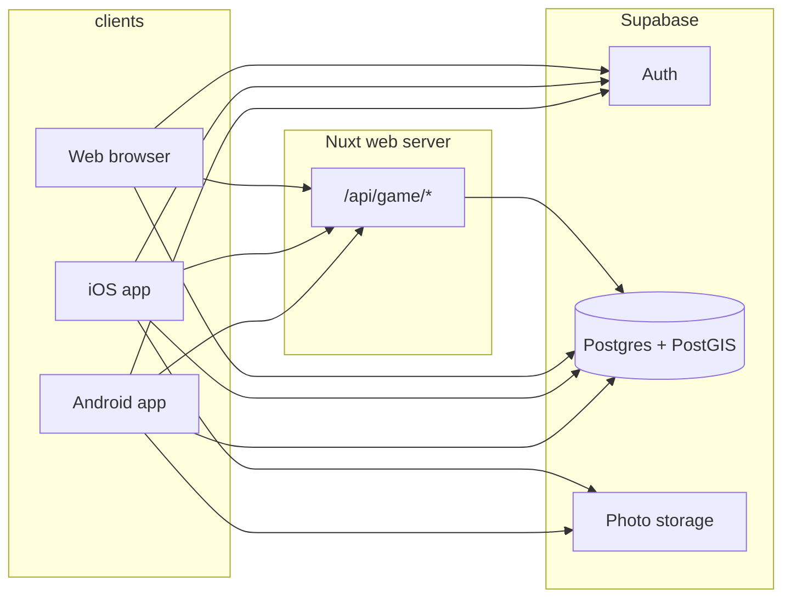

# Spot the Pothole — monorepo

A fun, non-commercial South African social game: spot potholes (live photo + GPS), name them, confirm them, and track fixes. Wards get response scorecards. **Phase 1 is English-only** with UI strings centralized in `shared/strings/` from day one.

> Never commit secrets, real user data, or photos. Seed data is fake/demo only.

## Repository layout

```
.
├── android/          # Kotlin + Jetpack Compose (Gradle)
├── ios/              # Swift + SwiftUI (XcodeGen project.yml)
├── web/              # Nuxt 4 + TypeScript (public UI + /api/game/* server routes)
├── supabase/         # SQL migrations (PostGIS, RLS), seed.sql
├── shared/           # en strings, TypeScript types, JSON schemas
└── docs/ROADMAP.md
```

## Architecture



**Direct to Supabase (clients):** authentication, reads (map/feed/profile), photo uploads to Storage.

**Via Nuxt server routes (game actions):** scoring rules, duplicate merge (~15 m), ward/authority lookup orchestration, moderation queues — implemented using service-role Supabase access and Postgres functions (`merge_report_into_pothole`, `lookup_ward_and_authority`, `record_confirmation` / points after 2 confirmations).

## Local setup

### Prerequisites

- Node.js 20+ and npm
- [Supabase CLI](https://supabase.com/docs/guides/cli) (Docker for local stack)
- JDK 17+ and Android SDK (for `android/`)
- macOS + Xcode + XcodeGen (for `ios/`)

### 1. Supabase (local)

```bash
cd supabase
supabase start          # first time: downloads containers
supabase db reset       # applies migrations/ + seed.sql
supabase status         # copy anon + service_role keys (do not commit)
```

### 2. Web (Nuxt 4)

```bash
cp web/.env.example web/.env
# fill NUXT_PUBLIC_SUPABASE_* and SUPABASE_SERVICE_ROLE_KEY from `supabase status`

cd web
npm install
npm run dev             # http://localhost:3000
```

Server route stubs live under `web/server/api/game/`.

### 3. Android

```bash
cp android/.env.example android/local.env   # reference only
# Set ANDROID_HOME / sdk.dir in android/local.properties (gitignored)

cd android
./gradlew assembleDebug
```

Use `10.0.2.2` host alias for emulator → local Supabase/Nuxt.

### 4. iOS (macOS)

```bash
cd ios
xcodegen generate
open SpotThePothole.xcodeproj
```

See `ios/README.md`.

## Environment variables

| Variable | Where | Purpose |
|----------|--------|---------|
| `NUXT_PUBLIC_SUPABASE_URL` | web | Supabase API URL |
| `NUXT_PUBLIC_SUPABASE_ANON_KEY` | web | Public anon key |
| `SUPABASE_SERVICE_ROLE_KEY` | web server only | Game routes / merges |
| `SUPABASE_URL` / `SUPABASE_ANON_KEY` | mobile | Client SDK (stub constants today) |
| `WEB_API_BASE` | mobile | Nuxt `/api/game` base URL |

Copy from root `.env.example` and per-package `.env.example` files — **placeholders only**.

## What is stubbed (Phase 1)

| Area | Status |
|------|--------|
| Map rendering (tiles + clustering) | List stub on web; placeholder screens on mobile |
| Camera capture + upload pipeline | Permissions declared; no CameraX/AVFoundation wiring |
| Live leaderboard from DB | API returns demo row without Supabase in CI |
| Ward scorecard UI | Schema + seed wards; UI placeholder |
| i18n beyond English | Strings file ready; no locale switching |
| Accessibility | Minimal; WCAG planned Phase 2 |
| Supabase client in mobile apps | BuildConfig / Info.plist placeholders + Supabase SDK wired (no real keys in git) |

## Scripts

| Command | Location |
|---------|----------|
| `npm run dev` / `npm run build` / `npm run lint` | `web/` |
| `./gradlew assembleDebug` | `android/` |
| `supabase db reset` | `supabase/` |

## License

See [LICENSE](./LICENSE) — MIT placeholder with a note that **AGPL is under consideration** before public launch.

## Roadmap

See [docs/ROADMAP.md](./docs/ROADMAP.md).
